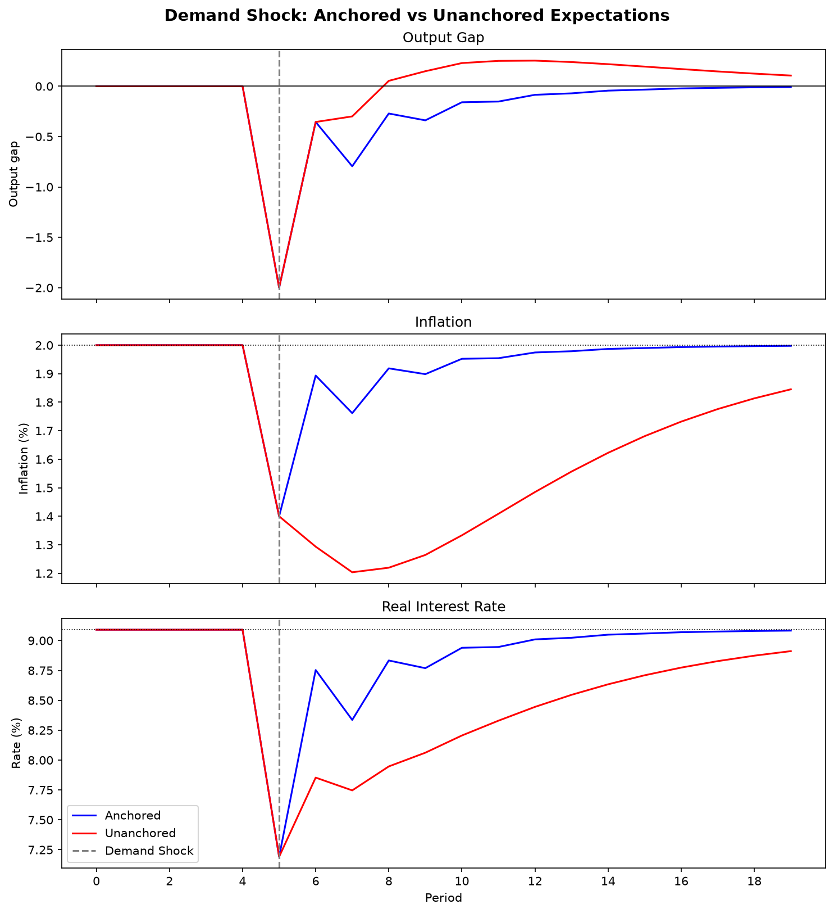
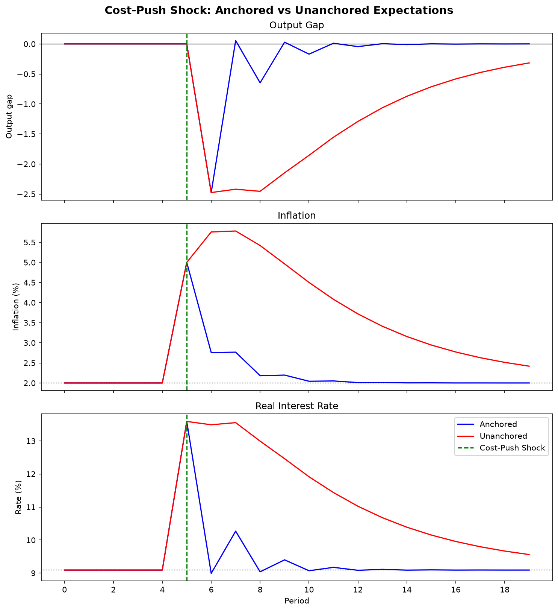

# nk-model-shock

A three-equation New Keynesian model. It hits the economy with a shock and
compares what happens when inflation expectations are anchored and when they
are not. Two shocks are available: a demand shock and a cost-push shock.

The model is not trying to measure a real shock. The shock sizes are inputs I
choose. The output is the comparison between the two regimes.

## The model

IS curve:

```
y_t = A + v_t - a * r_(t-1)
```

Phillips curve:

```
pi_t = pi_e + alpha * (y_t - y_e) + u_t
```

Taylor rule:

```
r_t = r* + phi_pi * (pi_t - pi*) + phi_y * (y_t - y_e)
```

`v_t` is the demand shock and `u_t` the cost-push shock. Either can be switched
off by setting its size to zero.

The real rate enters the IS curve with a one-period lag. A rate change today
does not move demand today: credit has to reprice and firms have to revise
budgets, and that takes time. The output gap enters the Phillips curve with no
lag, because a firm setting prices today can already see whether demand is
strong.

That lag is where the dynamics come from. Without it the model jumps straight
to equilibrium.

The neutral rate is not a free parameter. Setting the output gap and both
shocks to zero in the IS curve gives:

```
r* = (A - y_e) / a
```

## The two regimes

One line is different between them:

- **Anchored:** `pi_e = pi*`. People expect the target whatever inflation does.
- **Unanchored:** `pi_e = pi_(t-1)`. People expect last period's inflation.

Everything else is the same.

## The two shocks

Both shocks decay as AR(1) processes:

```
shock_t = rho * shock_(t-1)
```

**The demand shock** subtracts 2 from autonomous demand in period 5. With
`demand_rho = 0.7` it goes -2.00, -1.40, -0.98, -0.69 and so on toward zero.

**The cost-push shock** adds 3 points to inflation in period 5, with
`supply_rho = 0.5`. It raises inflation at an unchanged output gap: an energy
price jump, exchange-rate pass-through, a tax rise. It does not change
potential output, which is why it is a cost-push shock rather than a supply
shock in the wider sense.

An earlier version held the demand shock at full size for four periods and then
switched it off. That put a jump in demand on the period it ended, and some of
the oscillation in the results was coming from that jump instead of from the
model. With decay there is no end date to pick, and `rho` says how persistent
the shock is.

Both shocks are temporary. A permanent fall in `A` would also lower the neutral
rate, and since the Taylor rule keeps targeting the old `r*`, the chart would
end up showing the cost of a stale neutral rate instead of the cost of
unanchored expectations. That is a different question.

The two shocks are run separately, one chart each. Running them together makes
the charts unreadable: the responses overlap and you cannot tell which shock
produced which move.

## Parameters

Model:

| Parameter | Value | What it is |
|---|---|---|
| `a` | 0.55 | Interest sensitivity of demand |
| `alpha` | 0.3 | Slope of the Phillips curve |
| `phi_pi` | 1.5 | Taylor rule response to inflation |
| `phi_y` | 0.5 | Taylor rule response to the output gap |
| `pi_star` | 2 | Inflation target |
| `y_e` | 0 | Potential output, set to zero |
| `A` | 5 | Autonomous demand |

Shocks:

| Parameter | Value | What it is |
|---|---|---|
| `demand_shock_size` | -2 | Size of the demand shock |
| `demand_shock_start` | 5 | Period it hits |
| `demand_rho` | 0.7 | How fast it decays |
| `supply_shock_size` | 3 | Size of the cost-push shock |
| `supply_shock_start` | 5 | Period it hits |
| `supply_rho` | 0.5 | How fast it decays |

`phi_pi` has to be above 1. If the central bank raises rates less than
one-for-one with inflation, the real rate falls when inflation rises, policy
does not actually tighten, and the model does not settle.

I did not take `a` and `alpha` from data. I first ran the model with both set
to 1 and it blew up: output and inflation oscillated into the hundreds. I
lowered them until the oscillations died out. So these are values that keep the
model stable, not estimates of any economy.

The shock sizes and decay rates were chosen differently again: large enough to
make the response visible on a chart. They are not calibrated to anything, and
the two sizes are not comparable to each other — a demand shock of 2 is two
units of autonomous demand, a cost-push shock of 3 is three points of
inflation.

## Results

### Demand shock



Both regimes take the same hit in period 5: output 2 below potential, inflation
0.6 points below target.

| | Anchored | Unanchored |
|---|---|---|
| Period 10, output gap / inflation | -0.16 / 1.95 | +0.23 / 1.33 |
| Period 19, output gap / inflation | -0.01 / 2.00 | +0.11 / 1.85 |

With anchored expectations inflation is back at target in about ten periods.
With unanchored expectations it is still below target fourteen periods later,
and by then the output gap has turned positive. The central bank closed the gap
and overshot it, and inflation still has not come back.

The output gap panel looks backwards at first: the unanchored line recovers
faster and goes positive. The rate panel explains it. Inflation falls further
when expectations are unanchored, so the Taylor rule cuts the real rate harder,
and that extra stimulus pulls demand back faster. The central bank is easing
more in the unanchored case and still cannot get inflation back to target.

### Cost-push shock



The impact period is identical in both regimes: inflation jumps from 2.00 to
5.00 and the Taylor rule takes the real rate from 9.09 to 13.59. After that
they separate completely.

| | Anchored | Unanchored |
|---|---|---|
| Period 6, output gap / inflation | -2.48 / 2.76 | -2.48 / 5.76 |
| Period 7, output gap / inflation | +0.06 / 2.77 | -2.42 / 5.78 |
| Period 19, output gap / inflation | 0.00 / 2.00 | -0.32 / 2.42 |

Periods 6 and 7 are the interesting ones. The shock itself is decaying —
3, then 1.5, then 0.75 — so by period 7 three quarters of it has gone. Yet
under unanchored expectations inflation is still climbing, from 5.00 to 5.78.
The shock is fading and inflation is rising, because last period's inflation
has become this period's expectation and is feeding itself.

Under anchored expectations inflation peaks on impact and most of the work is
done in one period: 5.00 down to 2.76. The output gap oscillates for a few
periods as the rate rise and its reversal work through the lag, and everything
is back at equilibrium by period 13.

Under unanchored expectations output sits near -2.4 for three periods and is
still negative nineteen periods after the shock, with inflation at 2.42.

### Why the two differ

Under a demand shock there is a trade-off between the regimes. At period 19 the
unanchored economy has the **better** output gap (+0.11 against -0.01) and the
worse inflation (1.85 against 2.00). Losing the anchor costs something and buys
something.

Under a cost-push shock there is no trade-off. The unanchored economy is worse
on both counts: output -0.32 against 0.00, inflation 2.42 against 2.00. A
deeper and longer recession and higher inflation at the same time.

That is the case for anchoring expectations, in one model. Against demand
shocks an anchor is a mixed blessing. Against supply shocks it is the only
thing standing between a one-period price rise and a prolonged stagflation.

## Running it

```bash
python simulation.py
```

This writes both charts: `demand_shock.png` and `cost_push_shock.png`.

`functions.py` holds the model, the neutral-rate calculation and a helper that
turns the results into a DataFrame. `simulation.py` holds the plotting function
and runs the two scenarios.

All of the parameters live in one dictionary, `PARAMS`, which `simulate` takes
as an argument. To run a different scenario, copy the dictionary with the
values you want changed — the original is left untouched:

```python
demand_only = {**PARAMS, "supply_shock_size": 0}
cost_only = {**PARAMS, "demand_shock_size": 0}
```

`r*` is deliberately not in the dictionary, because it is derived rather than
chosen. `neutral_rate(params)` computes it from `A`, `y_e` and `a`. Both the
model and the chart call that function, so changing `a` moves the neutral rate
in both at once instead of leaving one of them stale.

## Limitations

- There is no lower bound on the interest rate.
- The shock sizes are choices, not measurements, and the two are not in
  comparable units.
- Backward-looking expectations are a simplification. Real expectations sit
  somewhere between the two cases here.
- The two shocks never arrive together here. Real economies get both at once,
  and the model can run that — it just produces a chart that is hard to read.
- This is not a model of any country. The parameters were picked for stability,
  and a 2% target does not describe Türkiye.